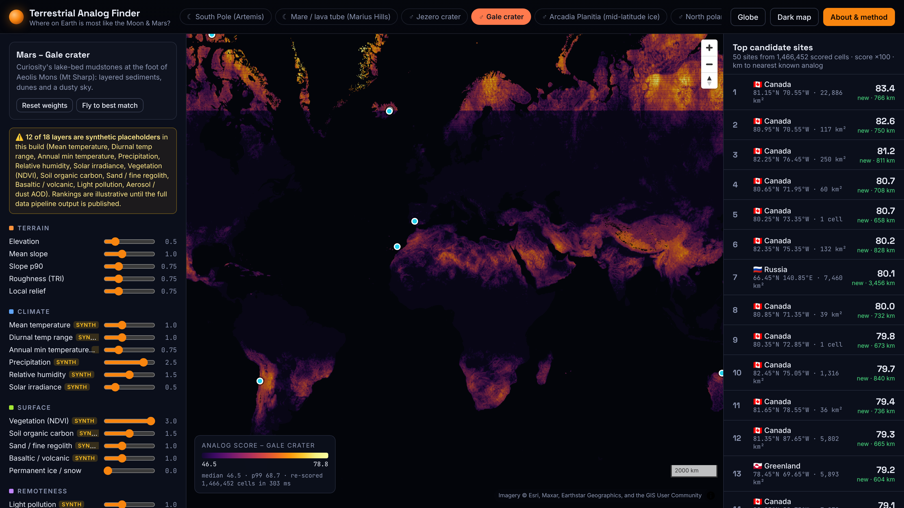

# Terrestrial Analog Finder

**NASA Space Apps Challenge 2026: Identify Earth Locations that Analog the Permanent Moon Base Locations and Mars**

Astronauts train, and rovers get tested, in places on Earth that resemble the Moon or Mars. Until now those analog sites have been chosen by expert intuition. Terrestrial Analog Finder describes **every one of Earth's ~2.1 million land cells (0.1°)** with **18 open data layers**: terrain, climate, surface, geology and remoteness, from NASA and partner agencies. It scores each cell against six planetary targets: the lunar south pole (Artemis), a lunar mare lava tube, and Mars' Jezero crater, Gale crater, Arcadia Planitia and the north polar deposits. Scoring runs live in your browser. You can reweight any factor, apply hard filters, and boost *novelty* to surface new candidates far from today's known analogs. Each candidate comes with an explanation and a 30 m terrain drill-down.

**Live demo:** https://site-comparer-thing.vercel.app (hosted on Vercel, rebuilt on every push to `main`; pull requests get preview URLs)



**Try it:** [take the 30-second guided tour](https://site-comparer-thing.vercel.app/#tour) · open the **Discoveries** tab for new candidates · open **Southern Africa** for the local story · **Copy link** on any site to share that exact view.

## What it finds

- **It recovers the famous analogs.** For Mars Jezero (ROC-AUC 0.92) and Gale (0.94), the Atacama, Death Valley and the Mars Desert Research Station land in Earth's top 2% of 2.1 million cells.
- **It knows its limits.** The polar and ice targets are weaker (0.58–0.73): they find the Antarctic Dry Valleys but undervalue humid Arctic sites. The lava-tube target waits for a real basalt layer. Every target shows its score in the app. Details and caveats: [`pipeline/report.md`](pipeline/report.md).
- **New candidates.** A fixed rule (Earth's top 1%, at least 500 km from any known analog) points to the cold high deserts of Central Asia. One of them, the western Qaidam Basin, was proposed as a Mars analog in 2017, and the method found it independently.
- **Southern Africa.** The Richtersveld and the central Namib reach Earth's top ~2% for Jezero and Gale. Vredefort scores low because no global layer records impact structures, and the app says so.

## How it works

1. **Offline pipeline (`pipeline/`, Python).** Fetches and caches each dataset, regrids it to a 0.1° EPSG:4326 grid, masks the ocean, and converts every feature to its **Earth-land percentile**. It quantises the results to `uint8` and writes `web/public/data/` (≈26 MB gzipped). It also builds target vectors from the literature, the known-analog list and a validation report (`pipeline/report.md`).
2. **Static web app (`web/`, Vite + TypeScript + MapLibre GL).** A Web Worker holds the feature matrix and re-scores all cells in a few hundred milliseconds whenever a control changes. It paints the map, clusters the top cells into sites, and powers the site card and the drill-down.
3. **Scoring.** The score is a weighted distance in percentile space: `S = 1 − √(Σ w (z − t)² / Σ w)`. Target values beyond Earth's range are clamped first, so the question becomes *how close can Earth get?*. See [`docs/scoring.md`](docs/scoring.md). Python and TypeScript implementations are checked against a shared fixture.

## Run the pipeline

See **[`pipeline/README.md`](pipeline/README.md)** for the step-by-step guide (Windows, macOS/Linux or Docker). In short:

```bash
bash pipeline/setup.sh
```

```bash
source .venv/bin/activate
```

```bash
python -m pipeline doctor
```

```bash
python -m pipeline run --quick
```

```bash
python -m pipeline run
```

```bash
python -m pipeline publish
```

## Run the web app locally

```bash
cd web
```

```bash
npm install
```

```bash
npm run dev
```

Regenerate the README screenshot and the link-preview image from the live site: `node web/scripts/screenshot.mjs` (needs Playwright).

Tests: `npm test` (web) and `python -m pytest pipeline/tests` (pipeline). **GitHub Actions is currently unavailable on this account (billing lock), so run the tests locally before opening a pull request.** Vercel still builds a preview for every pull request.

## Data sources

| Feature(s) | Preferred source | No-login fallback | Licence |
|---|---|---|---|
| Elevation, slope (mean, p90), roughness (TRI), local relief | [AWS Terrain Tiles](https://registry.opendata.aws/terrain-tiles/) (Terrarium; SRTM, GMTED, ETOPO1, NED…) | same | Open data, see [attribution](https://github.com/tilezen/joerd/blob/master/docs/attribution.md) |
| Mean / diurnal-range / minimum temperature | [MODIS MOD11C3 v061](https://doi.org/10.5067/MODIS/MOD11C3.061) | [NASA POWER](https://power.larc.nasa.gov/) T2M, T2M_RANGE, T2M_MIN | NASA open data |
| Precipitation, humidity, solar irradiance | [NASA POWER](https://power.larc.nasa.gov/) PRECTOTCORR, RH2M, ALLSKY_SFC_SW_DWN | same | NASA open data |
| Vegetation (NDVI) | [MODIS MOD13C2 v061](https://doi.org/10.5067/MODIS/MOD13C2.061) | [NASA GIBS](https://nasa-gibs.github.io/gibs-api-docs/) NDVI (colormap-decoded) | NASA open data |
| Soil organic carbon, sand fraction | [ISRIC SoilGrids 2.0](https://soilgrids.org) (5 km) | same | CC-BY 4.0 |
| Basaltic / volcanic fraction | [GLiM](https://doi.org/10.1594/PANGAEA.788537) (Hartmann & Moosdorf 2012) | same | CC-BY 3.0 |
| Permanent ice / snow | [MODIS MCD12C1 v061](https://doi.org/10.5067/MODIS/MCD12C1.061) class 15 | GLiM "ig", then [Natural Earth](https://www.naturalearthdata.com/) glaciated areas | NASA open data, CC-BY 3.0, public domain |
| Light pollution | [NASA Black Marble VNP46A4](https://blackmarble.gsfc.nasa.gov/) | NASA GIBS VIIRS Black Marble (brightness proxy) | NASA open data |
| Aerosol / dust AOD | [MERRA-2 M2TMNXAER](https://doi.org/10.5067/FH9A0MLJPC7N) | NASA GIBS AOD (colormap-decoded) | NASA open data |
| Land mask, countries | [Natural Earth](https://www.naturalearthdata.com/) 10m land, 50m admin-0 | – | Public domain |
| Planetary imagery (side by side) | [NASA Moon Trek / Mars Trek](https://trek.nasa.gov) WMTS: LRO WAC mosaic, Viking MDIM 2.1 | – | NASA open data |
| Basalt fallback | [Macrostrat](https://macrostrat.org) geologic map API (major mafic lithology) | – | CC-BY 4.0 |
| Planetary targets | Literature values: LOLA, Diviner, MOLA, REMS/MEDA, HiRISE/CRISM studies (citations in `targets.json` and on the About page) | – | – |
| Basemaps | Esri World Imagery, Esri Dark Gray Canvas, Esri Boundaries and Places labels | – | Attribution shown on map |

`meta.json` records which source was used for each feature. Synthetic placeholders appear only if a source was unreachable, and each one is flagged in the data and the UI.

## Repository layout

```
pipeline/   Python data pipeline (sources/, run.py, cli.py, tests/, README.md)
web/        Vite + TypeScript + MapLibre web app (src/, public/data/)
docs/       scoring spec, decisions log, demo script, fixtures
.github/    tests.yml, deploy.yml (legacy Pages, manual only), release-data.yml (manual)
web/vercel.json  Vercel cache headers (hosting)
```

## Libraries and credits

- Web: [MapLibre GL JS](https://maplibre.org) (BSD-3-Clause), [Vite](https://vitejs.dev) (MIT), TypeScript (Apache-2.0), Vitest (MIT). Fonts: Bricolage Grotesque, Instrument Sans, Martian Mono (SIL OFL, Google Fonts).
- Pipeline: NumPy, SciPy, rasterio, Shapely, GeoPandas, h5py (BSD), pyproj, pyogrio, pyhdf (MIT), Requests (Apache-2.0), Pillow (MIT-CMU), tqdm (MPL-2.0/MIT).
- No NASA logos or insignia are used. All screenshots are of this app.
- Full submission credits: [`docs/submission.md`](docs/submission.md).

## Use of AI

This project was built with Anthropic's **Claude** through the **Claude Code** coding assistant. Most of the code (pipeline, web app, tests) and much of the documentation was written by Claude under the team's direction, then reviewed and tested by the team. The team chose the challenge framing, the method (percentile normalisation, clamping to Earth's range, weighted distance, novelty), the target sites and default weights, and the validation design. The data pipeline ran on a team member's computer. Every literature value is cited, and judgement calls are logged in [`docs/decisions.md`](docs/decisions.md). No AI-generated images or video are used.

## Hosting

The site is a static Vite build on Vercel (project root `web/`, settings in [`web/vercel.json`](web/vercel.json)). Every push to `main` deploys, and every pull request gets a preview URL. Custom domain steps: [`docs/custom-domain.md`](docs/custom-domain.md).

## Team

NASA Space Apps 2026 team **[TEAM: name]**: [TEAM: member names, roles].

Built with open data from NASA, ISRIC, PANGAEA, Natural Earth and AWS Open Data.
