# Terrestrial Analog Finder

[](https://site-comparer-thing.vercel.app)


An open-data tool that finds places on Earth that resemble the sites planned for the Moon and Mars. It scores every one of Earth's roughly 2.1 million land cells (0.1° grid) against six planetary target sites, using 18 environmental layers from NASA and partner datasets. Scoring runs live in the browser, so every weight and filter can be changed and the map updates in a fraction of a second.

Built for the NASA Space Apps Challenge 2026: *Identify Earth Locations that Analog the Permanent Moon Base Locations and Mars*.

<p align="center">
  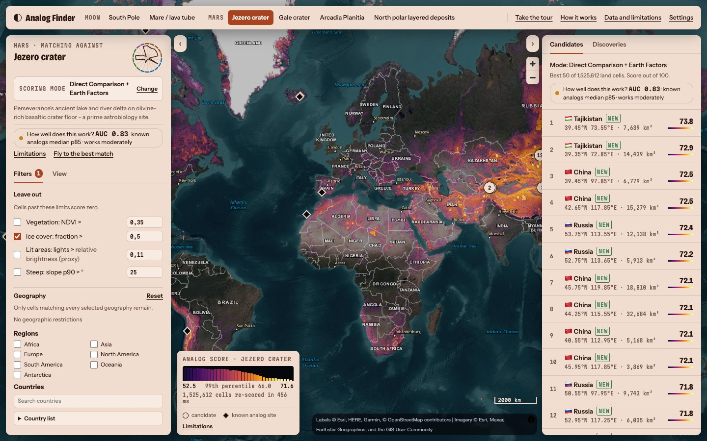
</p>
<p align="center"><em>Mars Jezero crater as the target. The heatmap shows how closely each land cell matches Jezero. The right panel ranks the best candidate sites.</em></p>

**Live demo:** <https://site-comparer-thing.vercel.app> · [30-second guided tour](https://site-comparer-thing.vercel.app/#tour)

---

## Contents

1. [Overview](#overview)
2. [Key features](#key-features)
3. [Screenshots](#screenshots)
4. [How it works](#how-it-works)
5. [Scoring modes and presets](#scoring-modes-and-presets)
6. [Validation and limitations](#validation-and-limitations)
7. [Technology stack](#technology-stack)
8. [System architecture](#system-architecture)
9. [Data sources and references](#data-sources-and-references)
10. [Project structure](#project-structure)
11. [Getting started](#getting-started)
12. [Configuration](#configuration)
13. [Testing](#testing)
14. [Deployment](#deployment)
15. [Documentation](#documentation)
16. [Future development](#future-development)
17. [Use of AI](#use-of-ai)
18. [Contributing, credits and licensing](#contributing-credits-and-licensing)

---

## Overview

### Problem

Astronauts train, and rovers are tested, in places on Earth that resemble the Moon or Mars. These *terrestrial analog* sites (Devon Island, the Atacama, Hawaiian lava tubes and so on) have mostly been chosen by expert judgement, convenience and precedent. There is no shared, reproducible way to ask which other places on Earth are similar, how similar they are, and why.

### Solution

The project turns that question into a measurement. Every land cell is described by the same 18 layers (terrain, climate, surface, geology and remoteness). Each planetary target is described in the same terms using published mission values. A transparent score then measures how far each cell is from each target, and the interface explains the result cell by cell.

### Objectives

- Make analog-site comparison **reproducible and inspectable**: the data pipeline, scoring formula and weights are open and documented.
- Make it **interactive**: a user can reweight any layer, switch scoring mode, filter by country or region, and see the effect immediately.
- Make it **honest about its limits**: every layer records which source was used, proxies are flagged, and known-analog validation is shown in the app.
- Surface **new candidates** away from today's known analogs, with a written characterisation of each.

The six targets are the lunar south pole (Artemis ridges near Shackleton), a lunar mare lava tube, and on Mars: Jezero crater, Gale crater, Arcadia Planitia and the north polar layered deposits.

---

## Key features

All of the following are implemented in the current code.

| Area | Capability |
|---|---|
| Comparison | 2,143,220 land cells × 18 layers scored against six Moon and Mars targets, in the browser (Web Worker), in a few hundred milliseconds |
| Scoring modes | Three modes for each of the Moon and Mars (Exploration, Direct Comparison, Direct Comparison + Earth Factors), with researched default weights, per-layer on/off and weight sliders, Save and Reset to default. Saved in the browser |
| Filters | Hard limits on vegetation, ice cover, night lights and steep slopes; searchable country and region selection; a *novelty* slider that favours places far from known analogs |
| Candidates | Top cells grouped into ranked candidate sites with area and country |
| Location view | Per-layer gap breakdown, an analog "fingerprint" chart, a full values table, side-by-side imagery with the target (NASA Moon/Mars Trek), and a 30 m terrain close-up with slope and roughness charts |
| Coordinate search | Type coordinates in the top bar (decimal, N/S/E/W or degrees-minutes-seconds; `/` focuses it) to fly to that cell and open its location view. A hint shows how the input was read and which country it falls in |
| Known analogs | 17 reference sites shown on the map; click one for its summary and score |
| Discoveries | Pre-computed headline candidates at least 500 km from any known analog, plus a southern Africa spotlight |
| Explanation | A nine-step "How it works" page with live demos, a guided tour, and a data and limitations page |
| Sharing | The whole view (target, mode, weights, filters, map position, selected site) is stored in the URL |
| Two ways to use it | The start screen offers **Normal Mode** (everything below) and **Simple Mode**: pick a place on the Moon or Mars, see the best matches on Earth, and read a plain-language result with the closest matches, biggest differences and a short explanation. Same data and scoring engine; advanced controls are hidden, not removed |
| Interface | Start screen, light and dark themes, optional blue/red tint when switching Moon to Mars, responsive layout with bottom sheets on phones |
| Data handling | Missing target values are never read as zero; soil layers are skipped on ice-sheet cells where the source has no soil ([details](docs/weights.md#measured-zero-missing-and-not-applicable)) |

---

## Screenshots

| | |
|---|---|
| 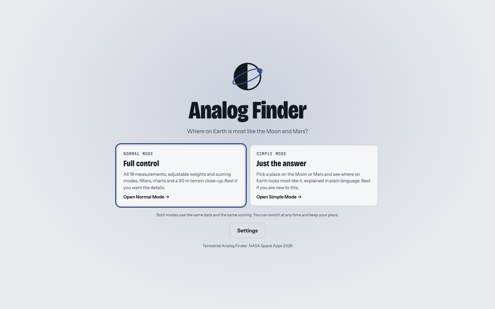 | 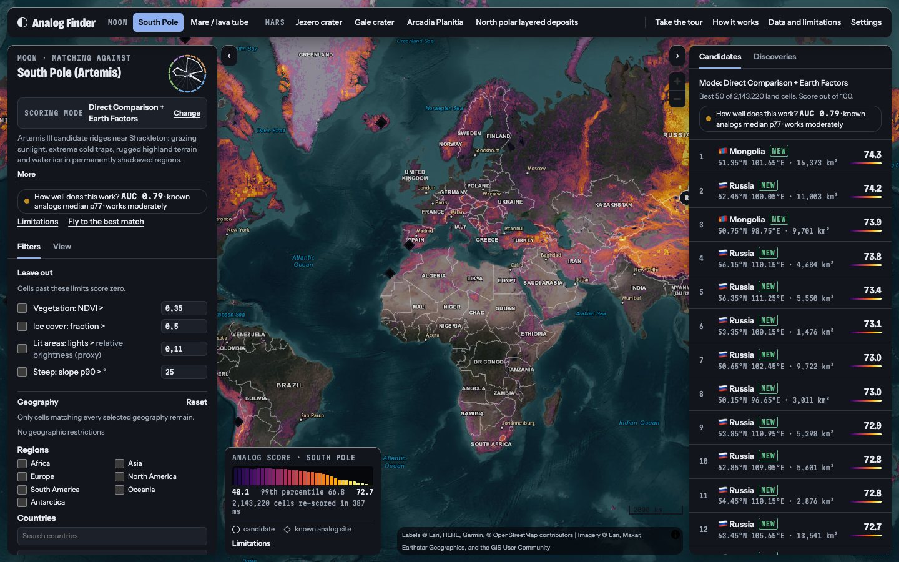 |
| *Start screen: choose Normal Mode or Simple Mode.* | *Normal Mode, dark theme, lunar south pole target.* |
| 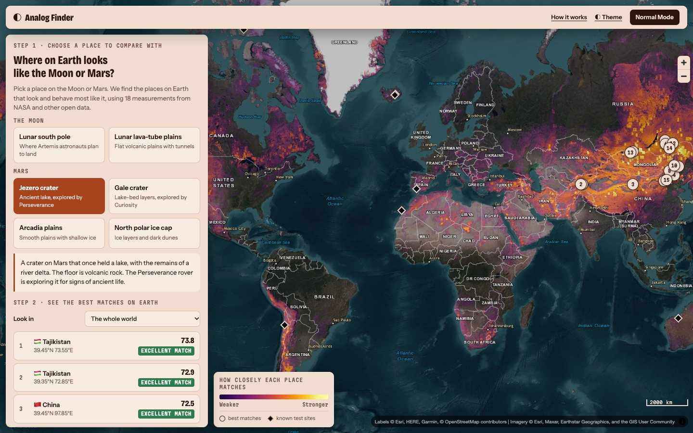 | 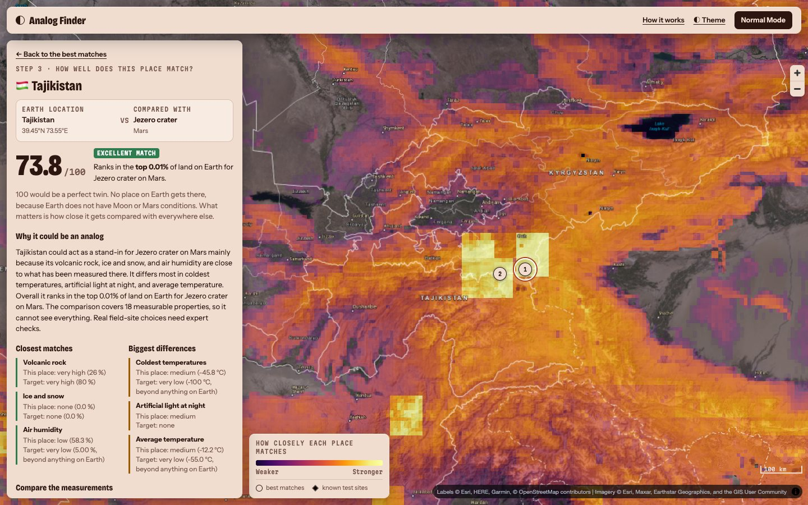 |
| *Simple Mode: pick a target and see the best matches.* | *Simple Mode result: score, explanation, closest matches and differences.* |
| 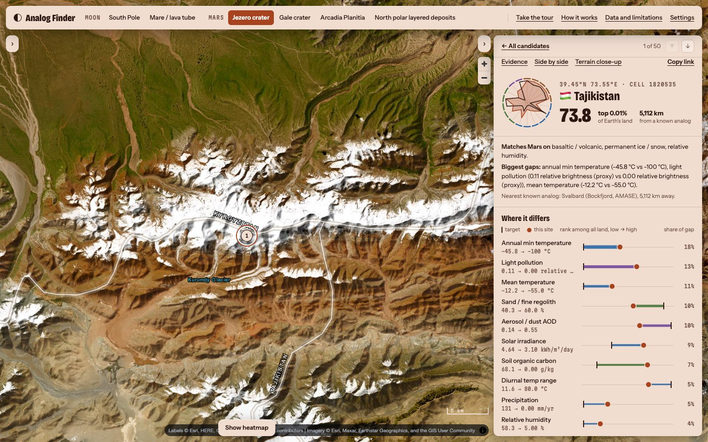 | 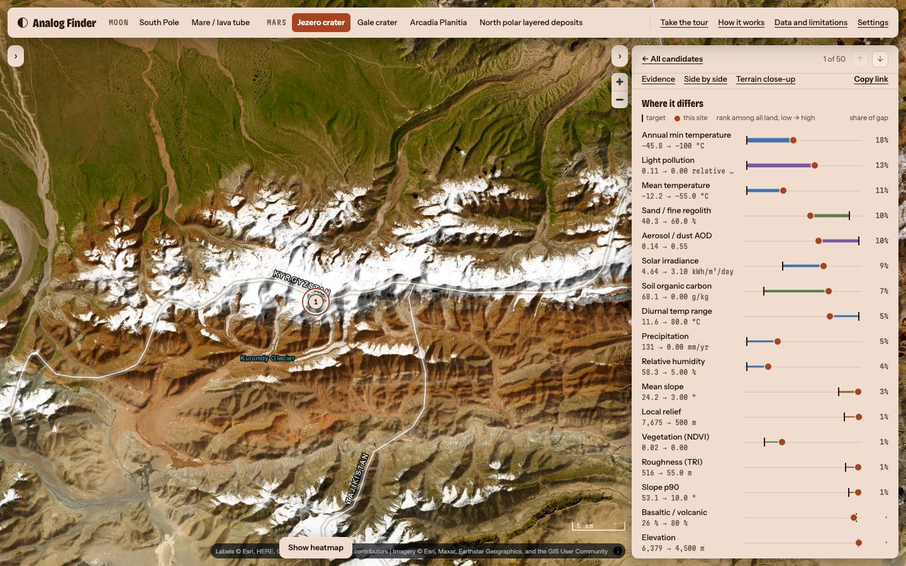 |
| *Location view: score, fingerprint chart and a plain-language summary.* | *"Where it differs": target (tick) against the site (dot) for each layer, with its share of the gap.* |
| 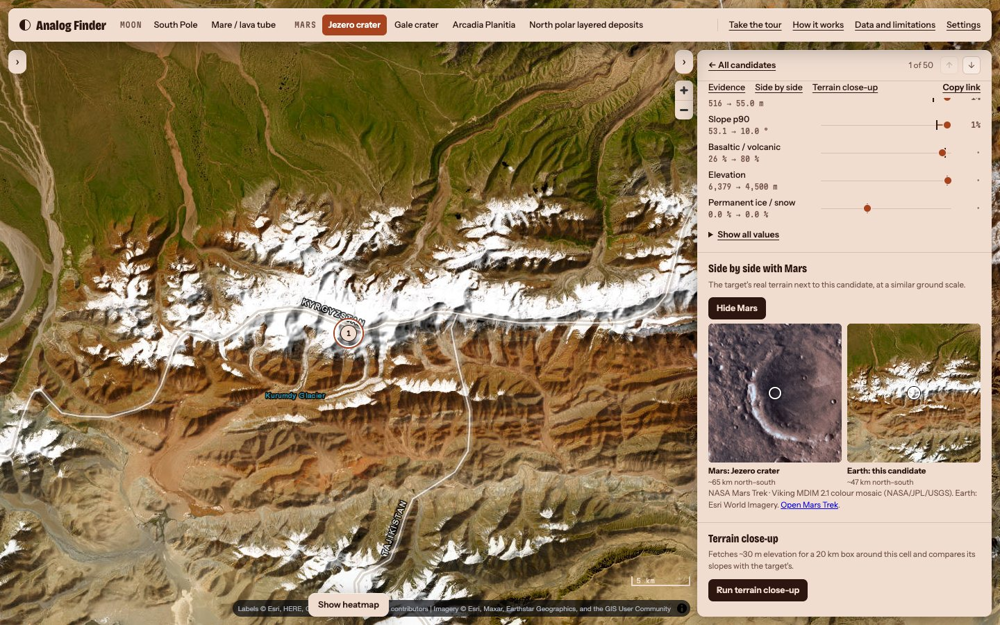 | 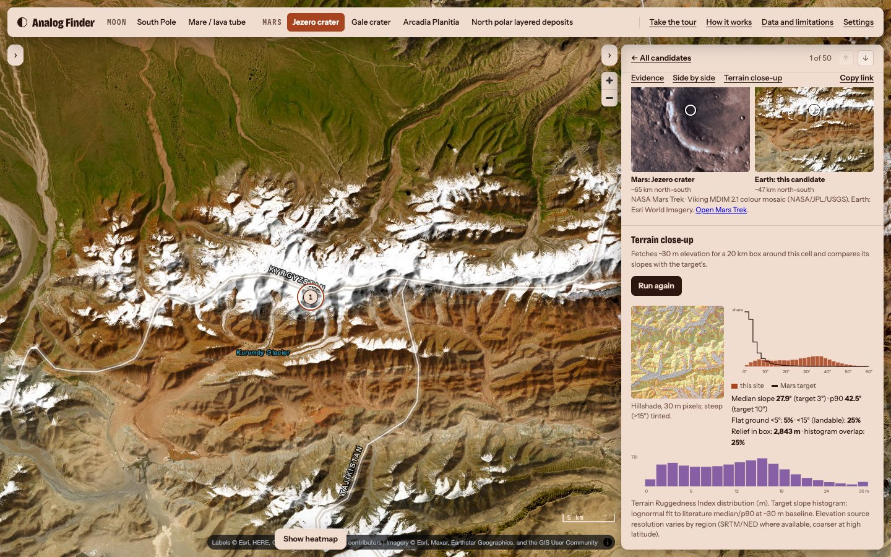 |
| *Side by side: Mars Trek imagery next to the Earth candidate.* | *Terrain close-up from 30 m elevation tiles, compared with the target's slope distribution.* |
| 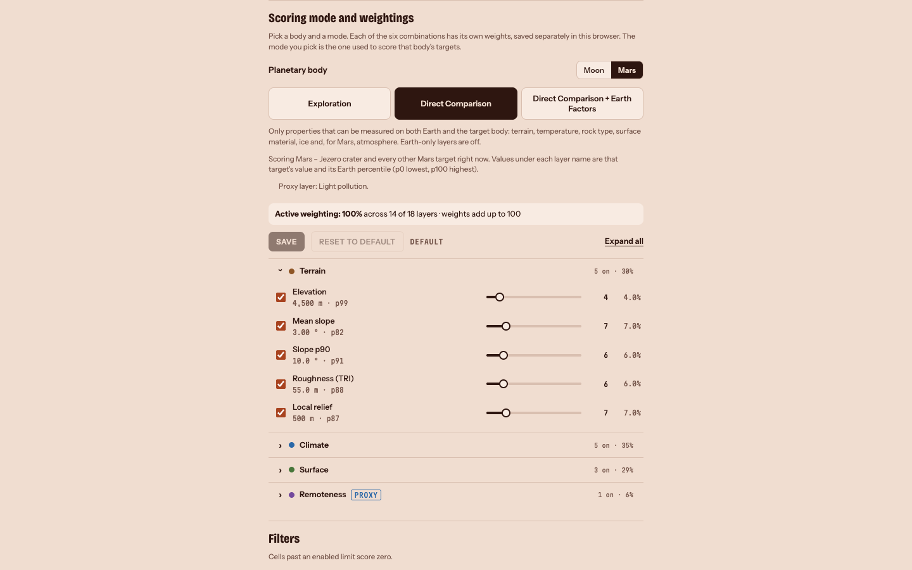 | 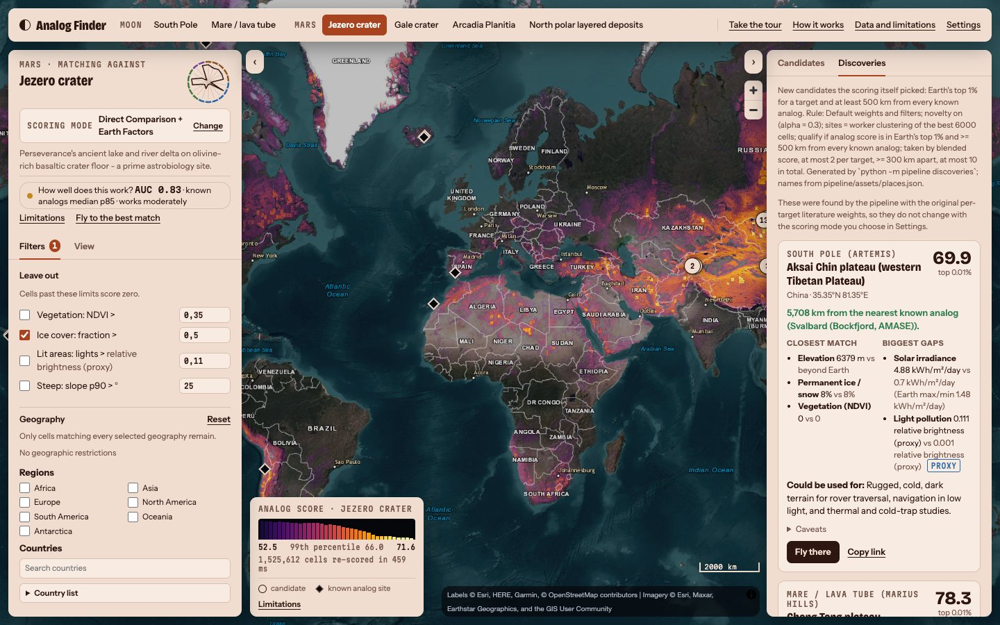 |
| *Settings: scoring modes and per-layer weights (Mars, Direct Comparison).* | *Discoveries: new candidates with closest matches and biggest gaps.* |

<p align="center">
  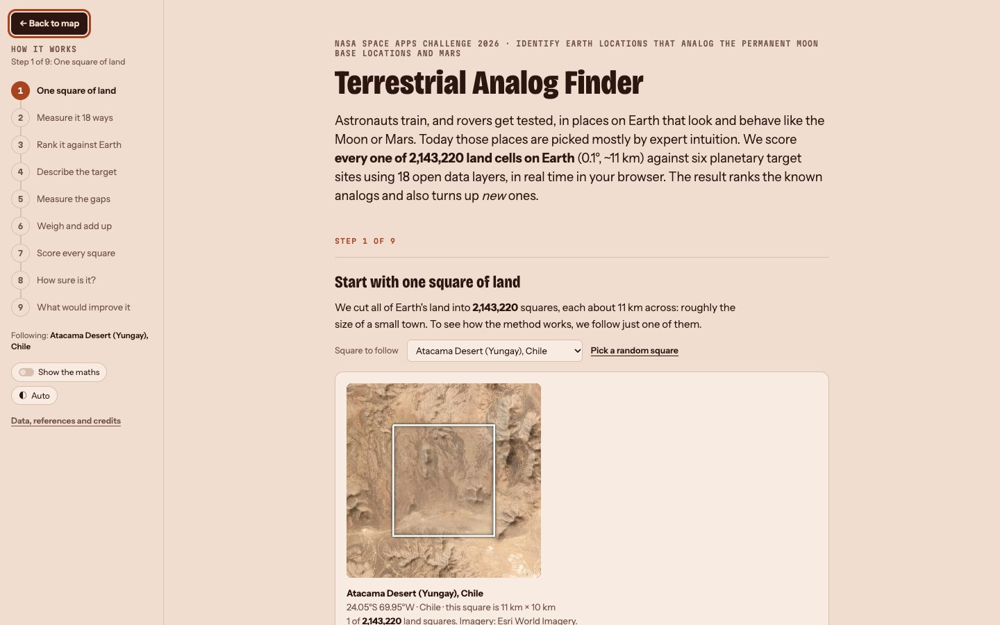
</p>
<p align="center"><em>The built-in explainer follows a single land square through all nine steps of the method.</em></p>

All images are captures of this application, taken from the running app.

---

## How it works

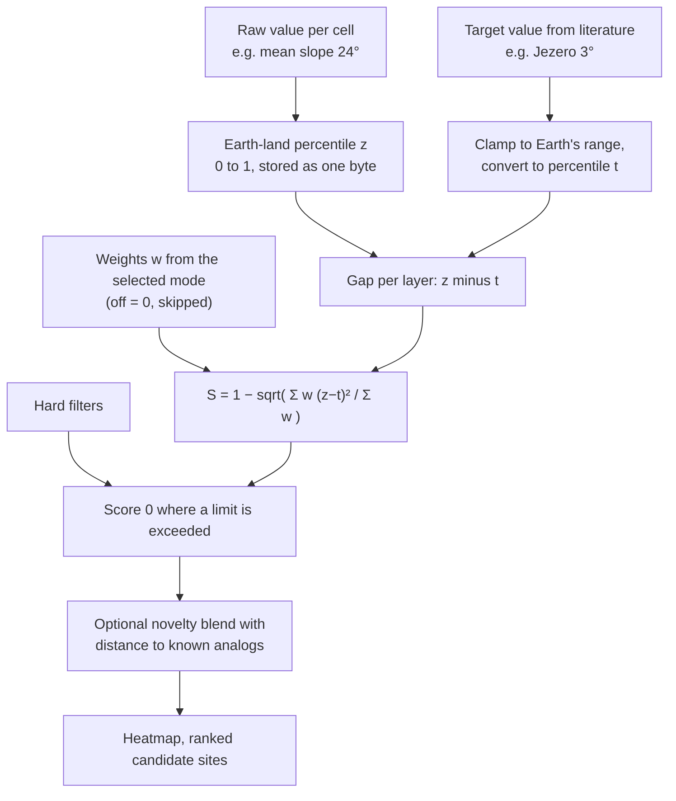

1. **Offline pipeline (`pipeline/`, Python).** Downloads each dataset, resamples it to a common 0.1° grid, masks the ocean, and converts every layer to its **Earth-land percentile** ("steeper than 97% of land"). Percentiles are quantised to one byte and written to `web/public/data/` (about 30 MB gzipped).
2. **Targets.** Each Moon and Mars target is described in the same 18 layers from published mission values (LOLA, Diviner, MOLA, REMS/MEDA and others). Values beyond anything on Earth are clamped to Earth's range first, so the question becomes *how close can Earth get?*
3. **Scoring in the browser.** A Web Worker holds the feature matrix and computes a weighted distance in percentile space: `S = 1 − √(Σ w (z − t)² / Σ w)`. A 256-entry lookup table per layer makes scoring all cells about 18 lookups each.
4. **Presentation.** The worker returns a heatmap image, the best sites and a score histogram. The page overlays them on a MapLibre map.

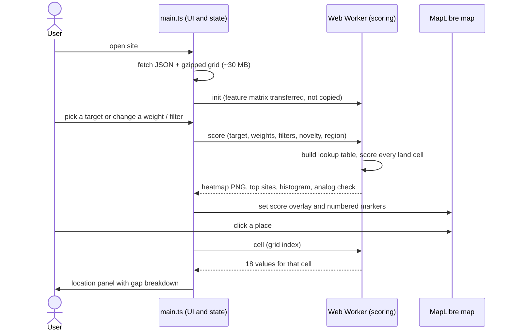

The scoring formula is specified in [`docs/scoring.md`](docs/scoring.md). A Python reference ([`pipeline/scoring.py`](pipeline/scoring.py)) and the TypeScript engine ([`web/src/scoring.ts`](web/src/scoring.ts)) are checked against a shared fixture.

---

## Scoring modes and presets

Weights say how much each layer counts. There are **six independent configurations**: three modes for each body. Each mode's enabled weights add up to 100 points, a switched-off layer contributes nothing, and the remaining weights are renormalised automatically.

| Mode | Purpose |
|---|---|
| **Exploration** | Properties that matter for exploring and for choosing analog research sites. Moon: geology, regolith, terrain, temperature, sunlight and water ice. Mars: geology, terrain, temperature, dust, atmospheric water and ice |
| **Direct Comparison** | Only quantities that can be measured on both Earth and the target body: terrain, temperature, rock type, surface material, ice, and for Mars the atmosphere. Earth-only layers (precipitation, vegetation, light pollution, soil carbon) are off |
| **Direct Comparison + Earth Factors** | Direct Comparison plus Earth-only conditions, limited to 12 of the 100 points so the physical and geological comparison still decides the ranking. This is the default |

| | Moon Exploration | Moon Direct | Moon Direct + Earth | Mars Exploration | Mars Direct | Mars Direct + Earth |
|---|---:|---:|---:|---:|---:|---:|
| Layers on (of 18) | 12 | 12 | 18 | 15 | 14 | 18 |
| Earth-only share | 0 | 0 | 12 | 5 | 0 | 12 |
| Heaviest layers (points) | basalt 18, ice 14, min temp 12, solar 10 | basalt 18, min temp 10, temp range 9, sand 9 | basalt 16, min temp 9, temp range 8, sand 8 | basalt 16, ice 11, dust 10, humidity 8 | basalt 15, humidity 8, mean temp 8, min temp 8 | basalt 13, humidity 7, mean temp 7, min temp 7 |

Users can change any weight or switch any layer on or off in **Settings**, then **Save** (stored in the browser's `localStorage`) or **Reset to default**. Each of the six configurations saves and resets independently, and unsaved edits are flagged. The mode in use is shown on the main page.

The full table of default weights, the sources behind each choice, and how measured zeros, missing data and quantities that do not exist on a body are told apart are in [`docs/weights.md`](docs/weights.md). The defaults are expert-judgement priors informed by the literature. They were not fitted to the known analogs.

---

## Validation and limitations

The pipeline tests whether each target's known analog sites outrank random land cells (ROC-AUC: 0.5 is chance, 1.0 is perfect). Values below are from [`web/public/data/validation.json`](web/public/data/validation.json), computed by the pipeline with the original per-target literature weights.

| Target | ROC-AUC | Median percentile of known analogs |
|---|---:|---:|
| Mars Jezero | 0.92 | 98 |
| Mars Gale | 0.94 | 99 |
| Moon South Pole | 0.72 | 85 |
| Moon Mare / lava tube | 0.68 | 80 |
| Mars Arcadia | 0.63 | 77 |
| Mars North Polar | 0.57 | 62 |

- For Jezero and Gale, the Atacama, Death Valley and the Mars Desert Research Station fall in Earth's top 2% of cells.
- The in-app validation badge is **recomputed live for the scoring mode in use**, so it differs from the table above. Direct Comparison modes score lower on this check than the original weights. A likely reason is that the known analogs are famous deserts, which the Earth-climate layers pick out, but this was not tested separately. Per-target and per-mode figures: [`docs/weights.md`](docs/weights.md#check-against-known-analogs-not-used-to-set-weights).
- **This is a sanity check, not an independent test.** The known analogs were chosen by the authors and are well-known sites.
- Polar and ice targets are weaker: they find the Antarctic Dry Valleys but undervalue humid Arctic sites. The lava-tube target is also weaker (0.68), and 0.1° cells cannot resolve individual lava tubes.
- No global layer records impact structures, so places such as Vredefort score low; the app says so.
- Several layers are proxies or fallbacks. In the published build, temperature comes from NASA POWER (the MODIS source needs an Earthdata token), light pollution is a brightness proxy from NASA GIBS, and elevation stands in for air pressure. `meta.json` records the source of every layer, and the app flags proxies.
- The 0.1° grid (about 11 km) blurs small features such as individual craters or lava tubes.
- Discoveries and the southern Africa spotlight were generated by the pipeline with the original per-target weights and do not change with the selected scoring mode.

More detail: [`pipeline/report.md`](pipeline/report.md) and the in-app "Data and limitations" page.

---

## Technology stack

| Layer | Technology |
|---|---|
| Frontend | TypeScript 5.9 (strict), Vite 6.4, MapLibre GL 5.24. No UI framework: HTML is generated from template strings |
| Computation in the browser | Web Worker (`web/src/worker.ts`, `scoring.ts`) |
| Data pipeline | Python 3.10–3.13 with NumPy, SciPy, rasterio, GeoPandas, Shapely, h5py, pyproj, Pillow, Requests, tqdm (pinned in [`requirements.txt`](requirements.txt)) |
| Data format | `uint8` percentile matrix as gzipped binary, plus JSON metadata, committed to the repository |
| Storage | No database or server-side storage. The visitor's browser stores settings in `localStorage` |
| Tests | Vitest (web), pytest (pipeline) |
| Hosting | Vercel static hosting; optional Docker image for the pipeline |
| Basemaps and imagery | Esri World Imagery, Esri Dark Gray Canvas, Esri labels, NASA Moon/Mars Trek, AWS Terrain Tiles |

There is **no application server and no API** of our own. Everything the browser needs is a static file.

---

## System architecture

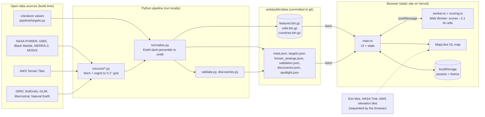

**Design decisions.** The data changes only when the pipeline is re-run, but scoring must react instantly to slider changes. So the heavy preparation happens once, offline, and the browser does the cheap per-request arithmetic itself. This removes the need for a server, a database or any per-user infrastructure. Judgement calls are logged in [`docs/decisions.md`](docs/decisions.md).

Further reading: [`BACKEND_GUIDE.md`](BACKEND_GUIDE.md) (pipeline and scoring engine) and [`FRONTEND_GUIDE.md`](FRONTEND_GUIDE.md) (interface and state), both written for readers new to the codebase.

---

## Data sources and references

`web/public/data/meta.json` records which source was actually used for each layer. Synthetic placeholders exist only as a last resort if every real source fails; none are used in the published build.

| Layer(s) | Preferred source | No-login fallback | Used in the published build | Licence |
|---|---|---|---|---|
| Elevation, slope (mean, p90), roughness (TRI), relief | [AWS Terrain Tiles](https://registry.opendata.aws/terrain-tiles/) (Terrarium; SRTM, GMTED, ETOPO1, NED…) | same | AWS Terrain Tiles | Open data, see [attribution](https://github.com/tilezen/joerd/blob/master/docs/attribution.md) |
| Mean, range and minimum temperature | [MODIS MOD11C3 v061](https://doi.org/10.5067/MODIS/MOD11C3.061) | [NASA POWER](https://power.larc.nasa.gov/) T2M, T2M_RANGE, T2M_MIN | NASA POWER | NASA open data |
| Precipitation, humidity, solar irradiance | [NASA POWER](https://power.larc.nasa.gov/) PRECTOTCORR, RH2M, ALLSKY_SFC_SW_DWN | same | NASA POWER | NASA open data |
| Vegetation (NDVI) | [MODIS MOD13C2 v061](https://doi.org/10.5067/MODIS/MOD13C2.061) | [NASA GIBS](https://nasa-gibs.github.io/gibs-api-docs/) NDVI (colormap-decoded) | NASA GIBS | NASA open data |
| Soil organic carbon, sand fraction | [ISRIC SoilGrids 2.0](https://soilgrids.org) (5 km) | same | SoilGrids | CC-BY 4.0 |
| Basaltic / volcanic fraction | [GLiM](https://doi.org/10.1594/PANGAEA.788537) (Hartmann & Moosdorf 2012) | [Macrostrat](https://macrostrat.org) mafic lithology | GLiM | CC-BY 3.0 |
| Permanent ice / snow | [MODIS MCD12C1 v061](https://doi.org/10.5067/MODIS/MCD12C1.061) class 15 | GLiM "ig", then [Natural Earth](https://www.naturalearthdata.com/) glaciated areas | GLiM "ig" | NASA open data, CC-BY 3.0, public domain |
| Light pollution | [NASA Black Marble VNP46A4](https://blackmarble.gsfc.nasa.gov/) | NASA GIBS VIIRS Black Marble (brightness proxy) | NASA GIBS (proxy) | NASA open data |
| Aerosol / dust AOD | [MERRA-2 M2TMNXAER](https://doi.org/10.5067/FH9A0MLJPC7N) | NASA GIBS AOD (colormap-decoded) | NASA GIBS | NASA open data |
| Land mask, countries | [Natural Earth](https://www.naturalearthdata.com/) 10 m land, 50 m admin-0 | – | Natural Earth | Public domain |
| Planetary imagery (side by side) | [NASA Moon Trek / Mars Trek](https://trek.nasa.gov) WMTS: LRO WAC mosaic, Viking MDIM 2.1 | – | (browser, on demand) | NASA open data |
| Basemaps | Esri World Imagery, Dark Gray Canvas, Boundaries and Places | – | (browser) | Attribution shown on the map |

Preferred sources that need a NASA Earthdata token are used only when one is configured ([Configuration](#configuration)).

### Scientific references

Planetary target values are taken from the literature. The full list with citation keys is in [`web/public/data/targets.json`](web/public/data/targets.json) and on the in-app About page. Key references:

- Lunar topography and slopes: Rosenburg et al. (2011), *JGR* 116, E02001 (LOLA); Barker et al. (2016), *Icarus* 273, 346.
- Lunar thermal environment and ice: Williams et al. (2017), *Icarus* 283, 300 (Diviner); Paige et al. (2010), *Science* 330, 479 (cold traps); Colaprete et al. (2010), *Science* 330, 463 (LCROSS); Li et al. (2018), *PNAS* 115, 8907.
- Lunar illumination, regolith and lava tubes: Mazarico et al. (2011), *Icarus* 211, 1066; McKay et al. (1991), *Lunar Sourcebook*; Haruyama et al. (2009), *GRL* 36, L21206.
- Mars landing sites and surface: Golombek et al. (2012), *Space Sci. Rev.* 170, 641; Kreslavsky & Head (2000), *JGR* 105, 26695; Tanaka et al. (2014), USGS SIM 3292.
- Mars atmosphere and climate: Martínez et al. (2017), *Space Sci. Rev.* 212, 295; Munguira et al. (2023), *JGR Planets* 128; Lemmon et al. (2015), *Icarus* 251, 96.
- Mars sites and ice: Farley et al. (2022), *Science* 377 (Jezero); Grotzinger et al. (2014), *Science* 343 (Gale); Bramson et al. (2015), *GRL* 42, 6566 and Morgan et al. (2021), *Nat. Astron.* 5, 230 (Arcadia ice); Byrne (2009), *Annu. Rev. Earth Planet. Sci.* 37, 535 (north polar).

Sources used to set the scoring-mode weights, with links, are listed in [`docs/weights.md`](docs/weights.md#sources-consulted).

---

## Project structure

```text
.
├── pipeline/                Python data pipeline
│   ├── cli.py, __main__.py   command line: doctor, run, status, publish, patch, discoveries, assets
│   ├── run.py                end-to-end recipe
│   ├── config.py             the 18-layer schema and source fallback chains
│   ├── sources/              one adapter per dataset
│   ├── normalize.py          Earth-land percentiles and binary export
│   ├── targets.py, analogs.py  Moon/Mars target values and known analog sites
│   ├── scoring.py, validate.py, discoveries.py
│   ├── assets/               committed land mask, country raster, gazetteer
│   ├── tests/                pytest suite
│   └── README.md             step-by-step pipeline guide
├── web/                     Vite + TypeScript + MapLibre web app
│   ├── index.html, vite.config.ts, vercel.json
│   ├── src/                  main.ts, worker.ts, scoring.ts, presets.ts, map.ts, settings.ts, ui/ ...
│   ├── public/data/          published dataset (generated by the pipeline)
│   ├── scripts/screenshot.mjs
│   └── tests/                Vitest suite
├── docs/                    scoring spec, weights, decisions log, submission text, images
├── .github/workflows/       tests.yml, deploy.yml (legacy, manual), release-data.yml (manual)
├── Dockerfile, docker-compose.yml, requirements.txt, .env.example
├── BACKEND_GUIDE.md, FRONTEND_GUIDE.md
└── README.md
```

Do not edit the files in `web/public/data/` by hand. Regenerate them with the pipeline.

---

## Getting started

### Run the web app locally

Requires Node.js 22 or newer (CI uses Node 22) and npm. The repository already contains the published dataset, so the pipeline is not needed to run the app.

```bash
git clone https://github.com/PseudonymD/site-comparer-thing.git
cd site-comparer-thing/web
npm install
npm run dev
```

Open <http://127.0.0.1:5173/> and choose **Normal Mode** or **Simple Mode** on the start screen. A link ending in `#ui=simple` opens Simple Mode directly. Other scripts:

```bash
npm run build     # type-check (tsc) and production build into web/dist
npm run preview   # serve the production build locally
npm test          # unit tests
```

The first load downloads about 30 MB of data. The map imagery needs internet access.

### Run the data pipeline (optional)

Only needed to regenerate the dataset. A full run takes hours and uses roughly 10 to 25 GB of disk (about 1.5 GB of downloads without an Earthdata token). From the repository root:

```bash
bash pipeline/setup.sh            # creates .venv (uses uv, falls back to venv + pip)
source .venv/bin/activate
python -m pipeline doctor         # checks Python, disk, RAM, network, token
python -m pipeline run --quick    # small smoke test (bbox-normalised, not publishable)
python -m pipeline run            # full run, resumable
python -m pipeline publish        # copy outputs to web/public/data and regenerate discoveries
```

Other commands: `status`, `patch --features <ids>`, `discoveries`, `assets`. Run options include `--res`, `--only`, `--bbox`, `--quick`, `--terrain-zoom`, `--force` and `--offline`.

Windows (`pipeline\setup.ps1`) and Docker (`docker compose build`, then `docker compose run --rm pipeline <command>`) are covered in [`pipeline/README.md`](pipeline/README.md).

---

## Configuration

| Variable | Used by | Purpose |
|---|---|---|
| `EARTHDATA_TOKEN` | Pipeline | Optional NASA Earthdata token. Enables the preferred MODIS, Black Marble and MERRA-2 sources. Leave empty to use the no-login fallbacks. Copy `.env.example` to `.env` (git-ignored); `pipeline/setup.sh` does this for you |
| `GLIM_PATH` | Pipeline | Optional path to a manually downloaded GLiM copy if the automatic download fails (`pipeline/sources/glim.py`) |
| `VITE_BASE` | Web build | Optional sub-path for hosting under a path other than `/` (default `/`) |

Browser storage keys (no server-side storage): `analog-finder-presets-v2` (scoring modes and saved weights), `analog-finder-settings` (theme and colour tint), `hiw-theme` (theme of the explainer page).

---

## Testing

```bash
cd web && npm test                          # 67 tests: scoring, presets, links, geography, tour, and the six modes on the published dataset
python -m pytest pipeline/tests             # 32 tests: sources, normalisation, scoring fixture, discoveries
```

`pytest` is not in `requirements.txt`; install it into the pipeline environment first (`pip install pytest`). After changing the scorer, regenerate the shared fixture with `python -m pipeline.tests.make_fixture`.

The workflow in [`.github/workflows/tests.yml`](.github/workflows/tests.yml) runs both suites and a production build on pull requests, but GitHub Actions is currently unavailable on this account (billing lock). Run the tests locally before opening a pull request. Vercel still builds a preview for every pull request. No automated tests cover the visual interface.

---

## Deployment

The site is a static Vite build on Vercel (project root `web/`, settings in [`web/vercel.json`](web/vercel.json)): `npm run build`, output `dist`. Every push to `main` deploys and every pull request gets a preview URL. `vercel.json` sets one-year immutable caching for built assets and the `.gz` data files, and revalidation for JSON; the app adds `?v=<data build time>` to the data file URLs so a new dataset is not served from cache. Custom domain steps: [`docs/custom-domain.md`](docs/custom-domain.md).

The Vercel project settings themselves are not stored in this repository.

---

## Documentation

| Document | Contents |
|---|---|
| [`docs/scoring.md`](docs/scoring.md) | Scoring specification |
| [`docs/weights.md`](docs/weights.md) | Default weights for the six modes, sources, data handling rules |
| [`docs/decisions.md`](docs/decisions.md) | Log of methodological decisions |
| [`pipeline/README.md`](pipeline/README.md) | Step-by-step pipeline guide |
| [`pipeline/report.md`](pipeline/report.md) | Latest validation report |
| [`BACKEND_GUIDE.md`](BACKEND_GUIDE.md), [`FRONTEND_GUIDE.md`](FRONTEND_GUIDE.md) | Architecture walkthroughs |
| [`docs/submission.md`](docs/submission.md), [`docs/slides.md`](docs/slides.md), [`docs/demo-script.md`](docs/demo-script.md) | NASA Space Apps submission material |

---

## Future development

These items are **not implemented**. They come from the project's own notes ([`docs/submission.md`](docs/submission.md), [`docs/weights.md`](docs/weights.md)).

- Absolute humidity instead of relative humidity.
- Real lithology everywhere, including mineralogy (the only geology layer is the basalt fraction).
- Finer grids for small features such as lava tubes.
- Expert review of the Discoveries.
- Run the pipeline's validation and Discoveries with the six scoring modes, and apply the browser's no-soil skipping in the Python reference scorer.
- Carry an explicit per-cell "no data" mask in the published data, and stop writing no-retrieval NDVI over ice as 0.

---

## Use of AI

This project was built with Anthropic's **Claude** through the **Claude Code** coding assistant. Most of the code (pipeline, web app, tests) and much of the documentation was written by Claude under the team's direction, then reviewed and tested by the team. The team chose the challenge framing, the method (percentile normalisation, clamping to Earth's range, weighted distance, novelty), the target sites and the validation design. The data pipeline ran on a team member's computer. Every literature value is cited, and judgement calls are logged in [`docs/decisions.md`](docs/decisions.md). No AI-generated images or video are used.

---

## Contributing, credits and licensing

**Contributing.** Issues and pull requests are welcome. Please run both test suites locally first (see [Testing](#testing)), keep the 18-layer order and `SCHEMA_VERSION` consistent between `pipeline/config.py` and the web app, and regenerate data with the pipeline instead of editing it. Contributors are listed on the [GitHub contributors page](https://github.com/PseudonymD/site-comparer-thing/graphs/contributors). Team and submission details: [`docs/submission.md`](docs/submission.md).

**Acknowledgements.** Open data from NASA (POWER, GIBS, Black Marble, MERRA-2, MODIS, Moon Trek, Mars Trek), ISRIC, PANGAEA (GLiM), Natural Earth, Macrostrat and AWS Open Data. No NASA logos or insignia are used.

**Libraries.**
- Web: [MapLibre GL JS](https://maplibre.org) (BSD-3-Clause), [Vite](https://vitejs.dev) (MIT), TypeScript (Apache-2.0), Vitest (MIT). Fonts: Bricolage Grotesque, Instrument Sans and Martian Mono (SIL OFL, via Google Fonts).
- Pipeline: NumPy, SciPy, rasterio, Shapely, GeoPandas, h5py (BSD), pyproj, pyogrio, pyhdf (MIT), Requests (Apache-2.0), Pillow (MIT-CMU), tqdm (MPL-2.0/MIT).

**Licence.** There is currently no `LICENSE` file in this repository, so no open-source licence has been granted for the code. Third-party data keeps its own licences, listed in the data table above.
